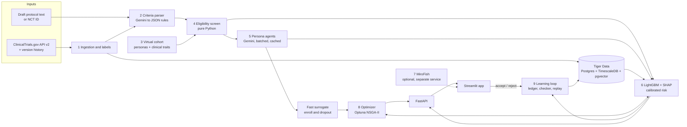

# Clinova: Master Overview and Architecture

Version 2.0 · October 10, 2026 · Source of truth for every human and AI agent working in this repo.

> **For AI agents:** this file is the product spec. `AGENTS.md` holds the working rules, `orchestration/PROTOCOL.md` holds the coordination rules, and `orchestration/tasks/<ID>.md` holds your task. When this file and a task file disagree, the task file wins for that task; note the conflict in your handoff.

---

## 1. Executive summary

Clinova is an open-source, AI-native flight simulator for non-small cell lung cancer (NSCLC) trials. It predicts where a draft protocol will stall enrollment or lose patients, then proves those predictions against how real trials turned out.

**Pitch:** test-fly your trial on thousands of virtual patients before enrolling a single real one, with every prediction graded against real trial outcomes.

**User:** a protocol author or study designer at a sponsor, before the protocol is finalized. Clinova advises the author; it never approves a protocol or makes a clinical decision.

**What it does, in five steps:**

1. **Read** a draft protocol or an NCT ID. Gemini turns eligibility rules and the visit schedule into code-checkable logic.
2. **Simulate** a virtual NSCLC cohort: persona records given clinical traits, screened in code, then run as Gemini agents who decide whether to enroll and when they would drop out.
3. **Calibrate** against reality with LightGBM trained on about 1,500 real ClinicalTrials.gov trials, explained by SHAP.
4. **Optimize** the protocol: test edits (relax a criterion, cut a visit) and show trade-offs between enrollment speed, dropout risk and diversity, with uncertainty ranges and a dollar value.
5. **Learn** over time: every prediction is logged in Tiger Data, scored when the real trial ends, and used to retrain.

**Proof, in three numbers on trials the model never saw:** accuracy versus a simple baseline, calibration, and hit rate (how often the criterion a sponsor later widened was in our top three flags). The demo backtests one real NSCLC trial terminated for poor accrual, starting from its first registered protocol.

**How it is built:** entirely by AI coding agents. Four orchestrator sessions (two Claude Code, two Codex, on two laptops) run 27 task prompts through subagents, coordinated by git tags and a shared Tiger Cloud database. Section 11 has the plan.

---

## 2. Problem and why it matters

Most trial delays are designed in: overly strict eligibility rules and heavy visit schedules are written into the protocol long before the first patient is screened.

| Bottleneck | Evidence | Source |
| --- | --- | --- |
| Protocol amendments | 57% of protocols have a substantial amendment; 45% of those are avoidable | Starter Sheet 01 |
| Amendment cost | Median $141K per amendment in Phase II, $535K in Phase III, plus about 3 months of delay | Starter Sheet 01 |
| Slow enrollment | Enrollment takes nearly twice as long as planned; 11% of sites enroll no one | Starter Sheet 02 |
| Cancer trial failure | 22.74% of 8,687 US cancer trials were terminated; accrual issues were the top specific reason (34.5%) | [PMC10028157](https://pmc.ncbi.nlm.nih.gov/articles/PMC10028157) |
| Where low accrual hits | 32.6% of trials terminated for low accrual were oncology; 52.6% were Phase II | [Clinical Trials Arena](https://www.clinicaltrialsarena.com/features/clinical-trial-terminations/) |
| AI adoption gap | Full AI implementation is lowest in trial design and planning | Tufts CSDD AI Benchmark 2024 |

The FDA-commissioned cost study (Sertkaya et al.) lists looser enrollment restrictions and simplified protocols with fewer amendments among its cost-reduction strategies. Clinova pulls exactly those two levers, before launch, when they are cheapest.

**Why NSCLC:** a large public trial history, recurring accrual problems, and direct relevance to Regeneron oncology (Libtayo). Fallback scope if labels run thin: all solid tumors.

---

## 3. Fit to judging criteria and starter sheets

| Judging criterion | How Clinova answers it |
| --- | --- |
| Utility and Relevance | Targets amendments and accrual failure in cancer trials, the rubric's own example. Every flag carries a dollar figure. |
| Readiness | Public data only. MIT license, one-command Docker Compose, seed data and recorded Gemini API outputs so judges can replay the demo exactly; Gemini runs live on new protocols. Tests and CI. |
| Design and Packaging | One results screen with three panels (funnel, risk, fixes). 3-minute video built on a real backtest. 12-slide deck. README quickstart. |

| Starter sheet | What we take | How we go further |
| --- | --- | --- |
| 01 Protocol Pre-Flight | Amendment-risk hotspots; every flag says where, why and what to do; human accept/reject | Flags scored by a model validated on real trials |
| 02 Site Unseen | Eligibility what-ifs on a synthetic population | Synthetic cohort plus behavioral persona agents, calibrated to outcomes |
| 15 Follow the Money | Cost of each protocol choice | Expected dollar value of an avoided amendment on every fix |
| GxP: The Validation Machine | Audit trail, traceability, human approval | Versioned predictions, logged decisions, requirements-to-tests traceability |
| Structural and Neurosymbolic AI kit | Predicting trial outcomes | We predict operational failure, where thousands of labels exist, not efficacy |

**Why judges remember it:** Sheet 01 assumes amendment data is private and tells teams to simulate it. Clinova uses ClinicalTrials.gov version history as a public proxy, so every claim can be checked. And the system was built by four AI orchestrators across two model families that reviewed each other's work.

---

## 4. System architecture



The optimizer and the model call each other: every candidate edit is re-scored in milliseconds by re-running the code screen, the surrogate and LightGBM. Accept/reject decisions flow back to the ledger. MiroFish (dashed) is optional and never on the critical path.

**Environments:** development and the live demo use one shared **Tiger Cloud** service (`DATABASE_URL` in `.env`). Judges use a **local TimescaleDB** container loaded from the seed dump; the schema is identical.

---

## 5. Components

Nine components. The core path (1 to 6, 8, 9) runs without MiroFish.

### 5.1 Data ingestion (`clinova/ingest/`)

Pulls Phase 2, Phase 3 and Phase 2/3 interventional NSCLC trials (about 1,500) from the ClinicalTrials.gov API v2: eligibility text, design, sites, countries, anticipated vs actual enrollment, status, why-stopped text. Pulls each trial's version history and stores every change as a time-stamped event (eligibility changed, enrollment target cut, completion date slipped, status changed).

**Labels** (only for trials that have ended):

- `label_accrual_fail`: status TERMINATED and why-stopped classified as `accrual` by Gemini (classes: accrual, safety, efficacy_futility, business_funding, other, unknown). Spot-checked by a reviewer agent from the other model family.
- `label_shortfall`: actual enrollment below 80% of the first version's anticipated enrollment.
- `label_amend`: eligibility text changed after the start date and the change is classified as widened or mixed (other classes: narrowed, administrative).

**Leakage rule:** features always come from each trial's first registered version, never its current record.

**Split:** train if start date is before 2018-01-01, test if on or after; trials not yet ended are `pending` and feed the learning loop.

### 5.2 Criteria parser (`clinova/parse/`)

Gemini turns free-text inclusion and exclusion criteria into structured `CriteriaRule` objects (field, operator, value, unit), one per atomic condition, mapped to a controlled vocabulary of clinical fields (`ClinicalField` in `contracts.py`). Units are normalized. Anything unmappable is flagged `unparseable`, never guessed. Deterministic sanity checks run after the model. A second function diffs two parsed versions per field (relaxed, tightened, removed, added) for the hit-rate metric.

Visit schedules are extracted when text is given. ClinicalTrials.gov records rarely include one, so the parser also estimates a schedule from design fields; estimated visits are marked `estimated=True` and labelled as such in the UI.

Embeddings: Gemini embeddings of first-version eligibility text, 768 dimensions, stored in pgvector for similar-trial search, precedents and the confidence badge.

### 5.3 Virtual cohort (`clinova/cohort/`)

Samples persona records (MatrAIx Persona 8B public coreset if its license allows; otherwise the best permissively licensed alternative found in spike T02) for life context: age, sex, race and ethnicity, job, caregiving, travel access, income band, risk tolerance, health literacy. Reweighted to NSCLC demographics. Each persona gets clinical traits (stage, histology, ECOG, organ-function labs, prior lines, brain metastases, EGFR/ALK/ROS1, PD-L1) sampled conditionally from published distributions in `clinova/cohort/assumptions.yaml`, where every number carries a source.

### 5.4 Eligibility screen (`clinova/simulate/screen.py`)

Applies parsed rules to every virtual patient in vectorized Python. Deterministic and fast (10,000 patients by 25 rules in under 50 ms), so the funnel shows exactly which criterion excludes whom and the optimizer can re-run it thousands of times. Reports both the sequential funnel and each rule's marginal exclusions.

### 5.5 Persona agents (`clinova/simulate/agents.py`, `runner.py`, `surrogate.py`)

Eligible virtual patients become Gemini agents shown a plain-language trial offer and visit-by-visit schedule. Each returns structured JSON: enroll yes/no, the visit where they would drop out, the reason and burden tags. 25 personas per call, fixed seeds, cached. Outputs per run: eligible fraction, enrollment rate, dropout curve, top burden reasons. A behavior check confirms that heavier protocols lower enrollment and raise dropout. A fast surrogate fitted on agent outcomes lets the optimizer re-score edits without new Gemini calls.

### 5.6 Prediction model (`clinova/model/`)

Inputs: protocol features (rule counts, per-field strictness relative to the training median, visit burden), design (phase, arms, masking, intervention types, first-version enrollment target), operations (sites, countries, sponsor class), 16 PCA components of the eligibility embedding (fit on train only) and simulation features. Start year and anything observed after the first version are excluded. Outputs: calibrated probabilities for accrual failure, shortfall and amendment, each with a range. SHAP explains every score. A logistic-regression baseline and a with/without-simulation ablation are always reported.

**Criterion flags:** each rule is ranked by how much predicted accrual-failure risk drops when that rule is relaxed one step or removed (re-screen, rebuild features, re-score). The top three become flags that say where, why and what to do.

### 5.7 MiroFish deep-dive (optional, `clinova/simulate/mirofish_client.py`)

Runs as a separate, unmodified service outside this repo (AGPL-3.0) on the demo trial only. Produces a narrative "community pulse" report on perceived burden. Cached. Cut at hour 8 if it isn't working.

### 5.8 Protocol optimizer (`clinova/optimize/`)

Generates candidate edits from the parsed protocol: relax ladders drawn from thresholds other NSCLC trials actually used, drop a rule, cut, merge or make remote a visit. Locked rules (pregnancy and consent capacity by default, plus any the author locks) are never touched. Optuna NSGA-II searches combinations of up to three edits. Objectives: enrollment speed, dropout risk, diversity of the eligible cohort. Returns three representative fixes (fastest, lowest dropout, balanced), each with ranges across cohort seeds and bootstrap models, the expected dollar value of an avoided amendment (drop in p_amend times the phase's median amendment cost), and precedent trials that used the looser rule and completed.

### 5.9 Learning loop (`clinova/loop/`)

Every prediction is stored with a timestamp and model version in a Tiger Data ledger. A checker re-fetches pending trials, records outcomes when they end, scores past predictions and triggers retraining. Accept/reject decisions and persona-realism ratings are logged as feedback and audit trail. The **time-machine replay** proves the loop: freeze the model at 2019-12-31, step monthly through 2020 to 2023, predict trials whose outcomes arrive in the next six months, then add that month's outcomes and retrain; compare against a frozen model.

---

## 6. Data model (Tiger Data)

One Postgres database: regular tables for trials and rules, TimescaleDB hypertables for time-stamped data, pgvector for similarity. Hypertable primary keys include the time column.

| Table | Type | Key columns | Owner task |
| --- | --- | --- | --- |
| `trials` | Table | nct_id, phase, start_date, status, why_stopped, stop_category, planned/actual enrollment, sponsor_class, n_sites, n_countries, first_version jsonb, current jsonb, label_accrual_fail, label_shortfall, label_amend, split | T11 |
| `trial_versions` | Hypertable (version_date) | nct_id, version_no, field, old_value, new_value | T11 |
| `criteria_rules` | Table | nct_id, version_no, rule_id, kind, field, operator, value, unit, raw_text, parse_status | T12 |
| `trial_embeddings` | Table + pgvector | nct_id, embedding vector(768), HNSW cosine index | T12 |
| `sim_runs` | Hypertable (run_at) | run_id, trial_id, seed, model_version, eligible_frac, enroll_rate, dropout_curve | T14 |
| `persona_outcomes` | Table | run_id, persona_id, eligible, enrolled, dropout_visit, reason, burden_tags | T14 |
| `sim_features` | View | one row per simulated trial | T24 |
| `predictions` | Hypertable (predicted_at) | prediction_id, trial_id, model_version, target, p, ci_low, ci_high | T21 |
| `outcomes` | Hypertable (observed_at) | nct_id, label, value, source | T21 |
| `prediction_scores` | Hypertable (scored_at) | prediction_id, target, p, y, month | T21 |
| `feedback` | Hypertable (created_at) | user, target_type, target_id, decision, comment | T21 |
| `fixes` | Table | fix_id, trial_id, edits jsonb, metrics jsonb, created_at | T23 |
| `drafts` | Table | draft_id, text, parsed jsonb, created_at | T25 |
| `llm_cache` | Table | key, namespace, model, request jsonb, response jsonb | T00 (shared) |
| `llm_usage` | Hypertable (created_at) | namespace, model, input_tokens, output_tokens | T00 (shared) |

A continuous aggregate over `prediction_scores` gives monthly Brier score and counts for the replay chart; AUC is computed in Python. (TimescaleDB cannot build a continuous aggregate over a join of two hypertables, so scores are materialized.)

**Example query the app runs:** among comparable NSCLC trials that required creatinine clearance of at least 60 mL/min, what share later widened that rule, and how many months after start?

---

## 7. Validation and metrics

Reported as a few plain numbers on trials the model never saw.

**Split:** time-based. Train on trials that started before 2018; test on trials that started 2018 or later.

| Metric | Plain-English question | Computed as | Shown in |
| --- | --- | --- | --- |
| Accuracy (AUC) | Does it rank failed trials above successful ones? | Test ROC AUC with bootstrap 95% CI, LightGBM vs logistic baseline | Validation tab, deck |
| Calibration | Does a 70% risk mean failure about 70% of the time? | Brier score and 10-bin reliability plot after isotonic calibration | Validation tab |
| Hit rate | Did we flag the rule the sponsor actually widened? | Share of test trials with `label_amend` where a relaxed or removed field is in our top three flags, against two baselines: three random rules, and the three rules with the largest marginal exclusion | Validation tab, deck, video |
| Simulation ablation | Does the simulation add signal? | AUC with vs without simulation features on the simulated test subset, paired bootstrap CI of the difference | Validation tab, deck |
| Replay curve | Does the learning loop help? | Monthly AUC and Brier, retrained vs frozen, 2020 to 2023 | Replay tab, video |

**Uncertainty:** ranges combine 30 bootstrap models with spread across simulation seeds. A confidence badge drops to "low" when a protocol's embedding distance to its 10 nearest training trials is above the training set's 90th percentile.

**Backtest:** one NSCLC trial from the test split, terminated for accrual, whose eligibility was widened before termination. Given only its first registered protocol, Clinova should flag the criterion the sponsor later widened. Selected automatically at Gate 1 by a stated rule, unless `DEMO_NCT_ID` is set in `.env`.

**Honesty rule:** report the numbers as they are. If the simulation adds no accuracy, say so; it still earns its place by explaining which rules and visits drive failure and by testing fixes.

---

## 8. User experience and demo flow

One results screen with three panels; everything else sits behind tabs.

1. Paste eligibility criteria and a visit schedule, or enter an NCT ID ("loads the protocol as originally registered on <date>").
2. Review the parsed rules (editable, lockable, unparseable rows highlighted) and press **Run Clinova**.
3. Results:
   - **Funnel:** virtual patients screened, excluded by each criterion, enrolled, completing.
   - **Risk:** calibrated probability of accrual failure, shortfall and amendment, each with a range, a confidence badge and top drivers in plain words.
   - **Fixes:** three trade-off fixes with effects on enrollment speed, dropout and diversity, ranges, dollar value and precedent trials. Accept or reject each; accepting re-runs fast and shows before and after.
4. Tabs: Validation, Replay, Community Pulse, Audit log.

**3-minute video:**

| Time | Scene |
| --- | --- |
| 0:00–0:20 | The problem, with dollar figures |
| 0:20–1:10 | Backtest: load the terminated trial's original protocol; the funnel stalls on one criterion; risk shows high |
| 1:10–1:30 | Reveal: version history shows the sponsor widened that exact rule, too late |
| 1:30–2:10 | Optimizer: three fixes with trade-offs and precedents; accept one and re-run |
| 2:10–2:40 | Proof: AUC vs baseline, calibration, hit rate, replay curve |
| 2:40–3:00 | Readiness: one command, MIT license, runs on any NCT ID, built by four AI agents |

---

## 9. Tech stack and repo layout

| Layer | Choice |
| --- | --- |
| Language | Python 3.11, managed with uv |
| AI | Gemini API via `google-genai` (fast model for parsing and persona agents, embedding model for vectors); model ids live only in config |
| Personas | MatrAIx Persona 8B public coreset, or the documented fallback |
| Social simulation | MiroFish, separate unmodified service, optional |
| Database | Tiger Cloud for dev and demo; local `timescale/timescaledb-ha` image for judges |
| Model | LightGBM, SHAP, scikit-learn isotonic calibration |
| Optimizer | Optuna NSGA-II |
| Backend / frontend | FastAPI / Streamlit |
| Packaging | Docker Compose, GitHub Actions CI, pytest, ruff |

```
clinova/
  AGENTS.md  CLAUDE.md              rules for every AI agent (CLAUDE.md imports AGENTS.md)
  docs/ARCHITECTURE.md              this file
  orchestration/                    SETUP, PROTOCOL, task prompts, launch prompts
  scripts/orch.sh                   coordination helper (tags, waits, notifications)
  .claude/agents/  .codex/agents/   subagent tiers (model + effort)
  clinova/
    common/        config.py, llm.py (only Gemini entry point), db.py
    contracts.py   shared pydantic models (frozen after T00)
    ingest/ parse/ cohort/ simulate/ model/ optimize/ loop/ api/ app/
  db/              schema.sql, seed/
  tests/           fixtures/, unit and integration tests
  docker-compose.yml  Makefile  pyproject.toml  LICENSE (MIT)  .env.example
```

**Environment variables** (`.env`, never committed): `GEMINI_API_KEY`, `DATABASE_URL` (Tiger Cloud connection string), `NTFY_TOPIC`, `MAX_GEMINI_CALLS` (default 12000 per key), `GEMINI_CONCURRENCY` (default 8), optional `DEMO_NCT_ID`, `SKIP_MIROFISH`, `CLINOVA_MODE` (demo or live).

**Readiness checklist:**

- [ ] `docker compose up` starts app, API and local TimescaleDB from the seed dump
- [ ] Demo mode replays recorded Gemini API outputs exactly, with zero network calls
- [ ] Live mode needs only `GEMINI_API_KEY` and optionally a Tiger Cloud `DATABASE_URL`
- [ ] MIT license; no MiroFish code in the repo
- [ ] pytest covers parser schema, screen logic, metrics, leakage and demo mode; CI green on every push
- [ ] README: 2-minute quickstart, architecture diagram, metrics, limitations

---

## 10. Risks, limitations and responsible use

| Risk | Likelihood | Fallback |
| --- | --- | --- |
| Running out of time | High | Cut order: MiroFish, then UI polish, then live mode (keep demo mode). Packaging is protected. |
| An orchestrator session dies | Medium | Launch prompts are idempotent: re-paste and they resume from git tags |
| Version history unreliable | Low–medium | Earliest-available vs current record comparison, documented |
| Simulation adds no accuracy | Medium | Report the ablation honestly; keep simulation for explanation and fixes |
| Too few clean NSCLC labels | Low–medium | Widen to solid tumors |
| Gemini rate limits or cost | Medium | 25 personas per call, cache everything, about 400 simulated trials, hard budget `MAX_GEMINI_CALLS` |
| Merge conflicts between agents | Medium | Frozen contracts, folder and table ownership, per-task handoff files, one integrator |
| Secrets leak | Low | `.env` gitignored; preflight aborts if it is tracked |

**Known limitations (on a slide):** registry edits are a public proxy for amendments, not the same thing; stop reasons are free text and some terminations are business decisions; personas are general-population records with clinical traits from published distributions, labelled as assumptions; predictions are correlational.

**Licensing:** MiroFish is AGPL-3.0: run it unmodified and separately, never copy it in. Verify the persona dataset's license before use. Pull ClinicalTrials.gov directly.

**Responsible use:** no real patient data. Clinova advises protocol authors and logs every accept/reject; it never approves a protocol.

---

## 11. Build plan: four AI orchestrators

Two people, each running one Claude Code orchestrator and one Codex orchestrator in separate clones. Each orchestrator receives one launch prompt (`orchestration/launch/`), runs its task queue through subagents with the model and effort set per task, waits on other orchestrators through git tags, and sends push notifications. `A-claude` is the integrator: it runs the bootstrap and every gate, and sends the final "all complete" notification. Tasks in the same wave never edit the same files, so they run in parallel across all four orchestrators.

```mermaid
gantt
  dateFormat HH:mm
  axisFormat %H:%M
  title Hours from kickoff
  section Gates (A-claude)
  T00 bootstrap + contracts :00:00, 60m
  G1 integrate             :04:30, 60m
  G2 freeze model          :10:00, 60m
  G3 merge                 :14:00, 15m
  G4 ship check            :15:30, 30m
  section A-claude
  T12 parser + embeddings  :01:00, 210m
  T22 model + validation   :05:30, 270m
  T31 Docker + seed        :11:00, 180m
  section A-codex
  T01 CT.gov spike         :00:00, 45m
  T11 ingestion            :01:00, 210m
  T14 persona agents       :01:00, 210m
  T21 learning loop        :05:30, 270m
  T24 batch simulation     :05:30, 270m
  T33 tests + CI           :11:00, 180m
  T41 README               :14:15, 75m
  section B-claude
  T02 personas spike       :00:00, 45m
  T03 clinical spike       :00:00, 45m
  T15 app shell            :01:00, 210m
  T16 MiroFish (optional)  :01:00, 420m
  T25 API + wiring         :05:30, 270m
  T32 app polish           :11:00, 180m
  T42 deck                 :14:15, 75m
  section B-codex
  T13 cohort + screen      :01:00, 210m
  T23 optimizer            :05:30, 270m
  T26 cross-model review   :09:00, 75m
  T34 validation doc       :11:00, 180m
  T43 video + submission   :14:15, 75m
```



| ID | Task | Owner | Subagent | Model | Effort | Deadline (h) |
| --- | --- | --- | --- | --- | --- | --- |
| T00 | Bootstrap, contracts, merge spikes | A-claude | clinova-architect | opus | xhigh | 1.0 |
| T01 | Spike: ClinicalTrials.gov and history | A-codex | clinova_researcher | gpt-6.1-sol | medium | 0.75 |
| T02 | Spike: personas, MiroFish, licenses | B-claude | clinova-researcher | sonnet | medium | 0.75 |
| T03 | Spike: NSCLC clinical distributions | B-claude | clinova-researcher | sonnet | high | 0.75 |
| T11 | Data ingestion and labels | A-codex | clinova_builder | gpt-6.1-sol | high | 4.5 |
| T12 | Criteria parser and embeddings | A-claude | clinova-builder | sonnet | high | 4.5 |
| T13 | Virtual cohort and code screen | B-codex | clinova_builder | gpt-6.1-sol | high | 4.5 |
| T14 | Persona agents and surrogate | A-codex | clinova_builder | gpt-6.1-sol | high | 4.5 |
| T15 | API and app shell on fixtures | B-claude | clinova-builder | sonnet | high | 4.5 |
| T16 | MiroFish (optional) | B-claude | clinova-builder | sonnet | medium | 8.0 |
| G1 | Gate 1: integrate, demo trial, label check | A-claude | clinova-integrator | opus | high | 5.5 |
| T21 | Learning loop and replay | A-codex | clinova_builder | gpt-6.1-sol | high | 10.0 |
| T22 | Model, validation, flags | A-claude | clinova-architect | opus | xhigh | 10.0 |
| T23 | Protocol optimizer | B-codex | clinova_builder_deep | gpt-6.1-sol | xhigh | 10.0 |
| T24 | Batch simulation | A-codex | clinova_builder | gpt-6.1-sol | high | 10.0 |
| T25 | API and app wiring | B-claude | clinova-builder | sonnet | high | 10.0 |
| T26 | Cross-model review of T22 | B-codex | clinova_reviewer | gpt-6.1-sol | xhigh | 10.25 |
| G2 | Gate 2: freeze model v1.0 | A-claude | clinova-integrator | opus | xhigh | 11.0 |
| T31 | Demo mode, seed, Docker, Tiger load | A-claude | clinova-builder | sonnet | high | 14.0 |
| T32 | App polish on real outputs | B-claude | clinova-builder | opus | high | 14.0 |
| T33 | Tests and CI | A-codex | clinova_builder | gpt-6.1-sol | high | 14.0 |
| T34 | Validation evidence (GxP-lite) | B-codex | clinova_light | gpt-6-luna | high | 14.0 |
| G3 | Gate 3: merge and clean-clone test | A-claude | clinova-integrator | opus | high | 14.25 |
| T41 | README and quickstart | A-codex | clinova_builder | gpt-6.1-sol | high | 15.5 |
| T42 | 12-slide deck | B-claude | clinova-builder | opus | high | 15.5 |
| T43 | Video script and submission text | B-codex | clinova_light | gpt-6-luna | high | 15.5 |
| G4 | Ship check, release, final notification | A-claude | clinova-integrator | opus | high | 16.0 |

Model names are current as of October 2026. If an account lacks a model, the orchestrator falls back to the best model it can use and says so in a notification.

**What people still do:** the one-time setup in `orchestration/SETUP.md`, paste one prompt into each of four sessions, keep laptops awake and online, then record the video from `docs/video/script.md` and submit when the final notification arrives.

---

## 12. Submission package and roadmap

**Deck (12 slides):** title and pitch; the problem with dollar figures; why now; what Clinova does; backtest; live demo screenshot; optimizer trade-offs; architecture; validation; learning loop; limitations and responsible use; roadmap and repo link.

**Roadmap:** expand to other indications (lymphoma, ophthalmology, immunology); site-level enrollment simulation; persona model tuned on expert feedback; structured protocol input (ICH M11); full GxP validation package.

---

## 13. Sources

- Regeneron starter sheets 01, 02, 15, the GxP sheet, the Structural and Neurosymbolic AI starter kit, and the HackRU judging criteria (project files)
- Tufts CSDD, AI Benchmark 2024; Sertkaya et al., Examination of Clinical Trial Costs and Barriers for Drug Development (project files)
- [Cancer trial terminations study (PMC10028157)](https://pmc.ncbi.nlm.nih.gov/articles/PMC10028157)
- [Clinical Trials Arena: clinical trial terminations](https://www.clinicaltrialsarena.com/features/clinical-trial-terminations/)
- [MatrAIx Persona 8B paper summary](https://hyper.ai/ar/papers/2608.04205)
- [MiroFish-Offline (AGPL-3.0)](https://github.com/nikmcfly/MiroFish-Offline/wiki)
- [Tiger Data on MLH](https://www.mlh.com/partners/tigerdata)
- [Claude Code subagents](https://code.claude.com/docs/en/sub-agents) and [Codex subagents](https://developers.openai.com/codex/subagents)
