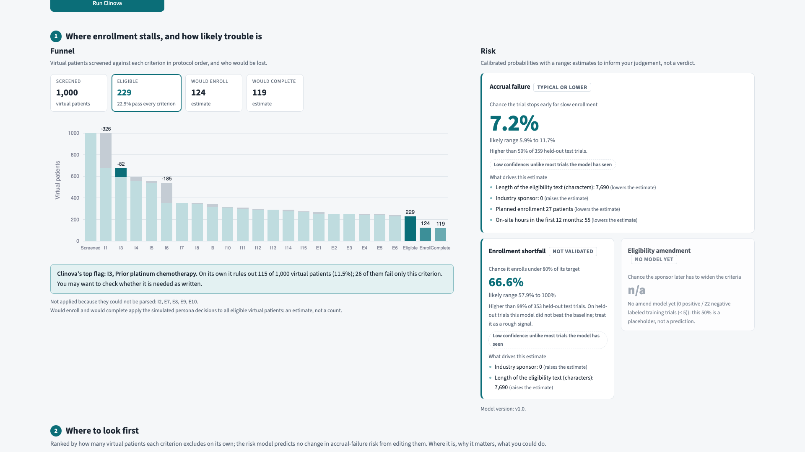
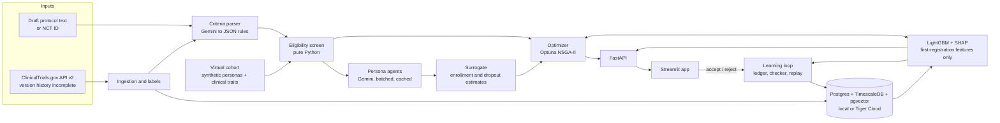

# Clinova

Test-fly a lung cancer trial protocol on virtual patients, then check its operational risk against real ClinicalTrials.gov outcomes.

[](https://github.com/RaghulKS/Clinova/actions/workflows/ci.yml)



**Research prototype. Clinova advises; the protocol author decides.** No real patient data. The demo combines a real registered trial, synthetic patients, cached Gemini responses and frozen model outputs. Its risk model missed the demo's accrual failure; the criterion review is useful to inspect, but has no validated hit rate.

## Try the demo

Install [Docker with Compose](https://docs.docker.com/compose/install/) and Git, then run:

```bash
git clone https://github.com/RaghulKS/Clinova.git
cd Clinova
docker compose up
```

Open **[localhost:8501](http://localhost:8501)**. Under **Load a registered trial**, enter **NCT03232892**, click **Load protocol**, review the rules, then click **Run Clinova**. Inspect the funnel, suggested fixes and **What happened next**; try **Accept** to compare a fix. **Validation** and **Replay** show the evidence and its limits.

Clinova is built on the Gemini API: Gemini parses eligibility criteria and the visit schedule, drives the persona agents and classifies trial outcomes. Demo mode replays the Gemini responses recorded during the build, so Compose loads the bundled database seed and model artifacts and the demo trial plays back exactly; add your `GEMINI_API_KEY` in `.env` to run Gemini live on new protocols. Exact demo risk, flags and fixes are tagged **cache**. Synthetic fallback data, when needed for other inputs, is tagged **fixture data**; an edited protocol can miss the cache.

Startup evidence: [T31's clean-path run](docs/handoff/T31.md) measured dependency setup at **9.8 s** and API/app startup at **35.9 s** against an already seeded database; Docker was unavailable on that host. Subsequently, [Gate 3](docs/gate3_report.md) measured a cold Docker build, seed load and healthy services in **89 s** on an Ubuntu GitHub runner, then passed the browser demo. These are measurements on those machines, not a startup guarantee. Stop the stack with `docker compose down`; its database volume is retained.

## What it does

1. Load a trial's first registered protocol or paste a draft; parse criteria into editable rules and flag text the parser cannot represent.
2. Screen a synthetic NSCLC cohort criterion by criterion, showing where virtual patients are excluded.
3. Simulate enrollment and visit burden using cached persona-agent decisions; show operational risks and their uncertainty.
4. Compare candidate edits for enrollment, dropout and demographic coverage; review and accept or reject them yourself.
5. Reveal the registered trial's outcome, inspect validation/replay, and record predictions and feedback in an audit ledger.

The architecture below follows [the design](docs/ARCHITECTURE.md#4-system-architecture), with the delivered cuts marked. The frozen risk model uses first-registration design/operations features; it excludes rule, screen, embedding and simulation features because their partial processing coverage tracked outcomes. Criterion flags rank synthetic exclusions, not modeled risk reductions. See [Gate 2](docs/gate2_report.md).



## Results, including the misses

Frozen model snapshot: **1,424 train rows; 360 test rows**, with missing target labels excluded per target. Values below are rounded from [metrics.json](docs/metrics.json); intervals are bootstrap confidence intervals. AUC measures ranking (higher is better); Brier measures probability error (lower is better). <!-- numbers: metrics.n_train metrics.n_test -->

| Target | Labeled test | Positives | Model AUC (95% CI) | Baseline AUC (95% CI) | Model Brier | Baseline Brier |
| --- | ---: | ---: | --- | --- | ---: | ---: |
| Accrual failure | 359 | 34 | 0.701 [0.623, 0.774] | 0.661 [0.593, 0.723] | 0.0827 | 0.0841 |
| Shortfall | 353 | 192 | 0.598 [0.538, 0.655] | 0.605 [0.554, 0.661] | 0.2518 | 0.2483 |

- **Accrual failure:** above-chance ranking, with no established improvement over logistic regression; paired difference intervals include zero, and probabilities are compressed ([Gate 2 analysis](docs/gate2_report.md)).
- **Shortfall:** not validated; ranking and probability error are worse than the logistic baseline.
- **Amendment:** no trained model; **hit rate** and **simulation ablation** are unavailable, rather than measured zeros. Histories and sufficient behavioral simulation coverage are missing.
- **Replay:** pooled Brier **0.078241 retrained vs 0.076678 frozen**, across **1,736 overlapping windows**, **324 unique trials** and **216 initial training trials** ([replay.json](docs/replay.json)). Monthly updates did not improve pooled error; retrospective completion dates proxy observation time, and repeated windows are not independent trials. <!-- numbers: replay.summary.retrained_brier replay.summary.frozen_brier replay.summary.n_scored replay.summary.n_unique replay.summary.n_train -->

**Demo backtest - NCT03232892:** the real trial terminated for low accrual, enrolling **1 of 27 planned**. The frozen model gave accrual risk **7.2%**, with a **5.9%-11.7%** range: a miss. Its top exclusion flag was prior platinum therapy, a restriction absent from the current text. This first-versus-current comparison does **not** establish a dated amendment or prove the flag caused a better outcome. See [demo provenance](docs/demo_trial.md), [frozen scores](docs/demo_results/NCT03232892.json) and [screen evidence](docs/screens/README.md).

## How we validate

Trials starting before 2018-01-01 train the model; later starts form the test set. Features use first registration only; current status, stop reason and actual enrollment are label-side. Tuning and calibration stay within training data. We compare LightGBM with logistic regression, report bootstrap AUC intervals, Brier error and calibration, and retain missing labels. Criterion hit rate is unavailable because amended test labels are missing; simulation ablation is unavailable because coverage is insufficient. We audited leakage and statistics in a separate review pass; the blind stop-reason spot-check and subsequent keyword-label agreement are disclosed separately. Ended-trial selection, partial histories and retrospective replay timestamps limit interpretation. [Validation and requirements-to-tests evidence](docs/VALIDATION.md); [cross-model review](docs/reviews/T26.md).

## Live mode

After trying the seed, create a local `.env` containing `CLINOVA_MODE=live` and your `GEMINI_API_KEY`. Keep it private. The local database remains the default. Optionally set `DATABASE_URL` to a Tiger Cloud PostgreSQL connection with TimescaleDB and pgvector; seed/schema setup is documented in [T31](docs/handoff/T31.md). For an already prepared external database, run `docker compose up api app`.

Gemini calls pass through the shared cache, retry and budget layer; quota exhaustion can leave a stage unavailable or visibly using fixtures. Live mode is not a guarantee that an arbitrary draft has validated predictions. The frozen model stays pinned; retraining and outcome checking are separate operations. [Configuration](clinova/common/config.py), [contracts](docs/CONTRACTS.md) and [component commands](docs/ARCHITECTURE.md#5-components) explain those workflows.

## Limits, responsible use and licenses

- This is operational decision support, not medical advice, clinical validation or protocol approval. A qualified author must review parsed rules, locked safety conditions and every suggested edit. Do not upload real patient records or confidential protocols to this prototype.
- The retrospective cohort includes only observed ended trials for labeled outcomes and may include basket studies. Labels mix Gemini/cached classifications with a disclosed keyword rule. Incomplete ingestion is not a complete registry sample; source corrections and unfinished histories can change results.
- Synthetic clinical/social priors and agent choices are assumptions, not patient behavior measurements. The surrogate's historical training includes fixture protocols; dropout agreement underperformed its majority baseline. No simulation accuracy benefit, amendment savings or hard latency bound is established.
- The ledger supports traceability, but the prototype has no authenticated user identity or production access controls. Fixture audit rows are temporary. This is a GxP-inspired evidence package, not GxP certification.
- Clinova code is [MIT](LICENSE). [ClinicalTrials.gov](https://clinicaltrials.gov/) is the public registry source; source/retrieval evidence and use terms are discussed in [data provenance](docs/VALIDATION.md#data-provenance-and-labels) and [the license inventory](docs/spikes/personas_mirofish.md#3-license-table-docsarchitecturemd-dependencies-and-data).
- Optional persona context is **NVIDIA Nemotron-Personas-USA**, **CC BY 4.0**, selected and resampled with derived traits; [attribution and changes](clinova/cohort/PERSONAS_ATTRIBUTION.md) distinguish observations from assumptions. The seed also contains synthetic cohort/model artifacts and cached Gemini outputs, governed by the respective upstream terms. Research-only persona datasets were rejected and are not shipped.
- The agent simulation engine is our own, written from scratch and inspired by multi-agent social simulation projects such as MiroFish. No code from those projects is included, so Clinova stays MIT. Other dependency licenses remain their own.

## Who built this

Two of us built Clinova for HackRU, including our own agent simulation engine. It draws on Regeneron's Protocol Pre-Flight, Site Unseen, Follow the Money and validation starter materials. Tests and review findings are recorded with their limitations; see the [handoffs](docs/handoff/) for build notes.

## Repo map and tests

| Path | Purpose |
| --- | --- |
| `clinova/ingest`, `parse` | Registry records, labels, criteria and embeddings |
| `clinova/cohort`, `simulate` | Synthetic patients, screening, agents and surrogate |
| `clinova/model`, `optimize`, `loop` | Risk, proposed edits, audit and replay |
| `clinova/api`, `app` | FastAPI and Streamlit |
| `db/schema.sql`, `db/seed` | Schema and demo artifacts (recorded Gemini outputs, seed data) |
| `tests`, `.github/workflows/ci.yml` | Regression checks on recorded Gemini responses, plus container/browser smoke |
| `docs/VALIDATION.md`, `docs/gate*_report.md` | Evidence, provenance and disclosed cuts |

For development, install [uv](https://docs.astral.sh/uv/getting-started/installation/) (the lock selects Python 3.11). From the cloned repository:

```bash
uv sync --frozen
uv run ruff check .
uv run pytest -q
```

These are the checks behind `make check` (GNU Make on Linux/macOS). Tests block external network access and isolate settings; seeded database/browser acceptance is separate. [Gate 3](docs/gate3_report.md) records the passing Ubuntu `make check` and Docker/Playwright smoke. [Full validation guide](docs/VALIDATION.md).
